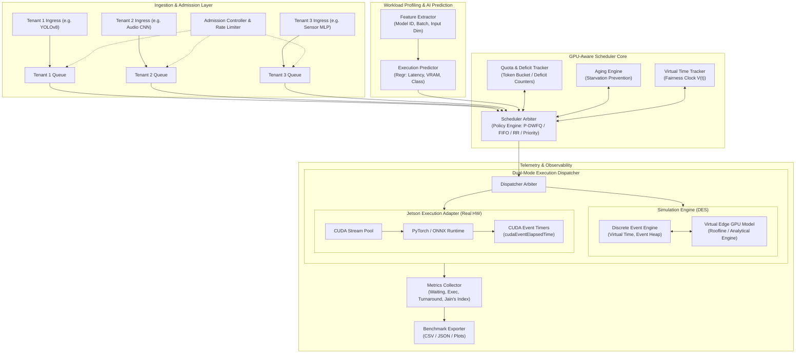
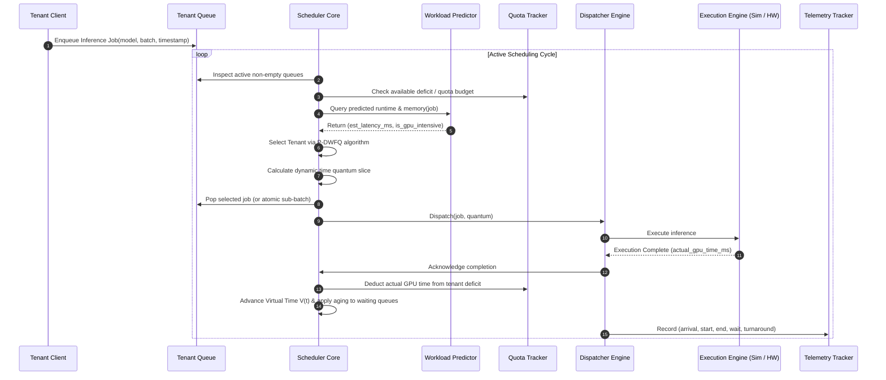
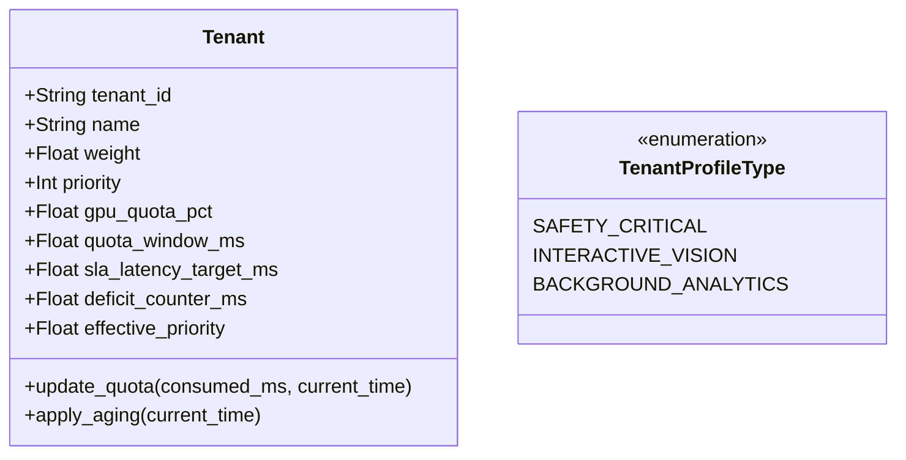
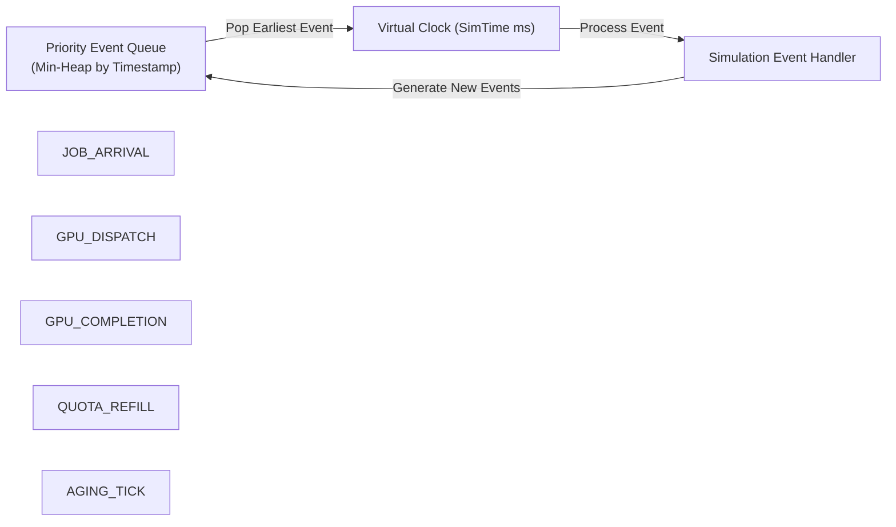
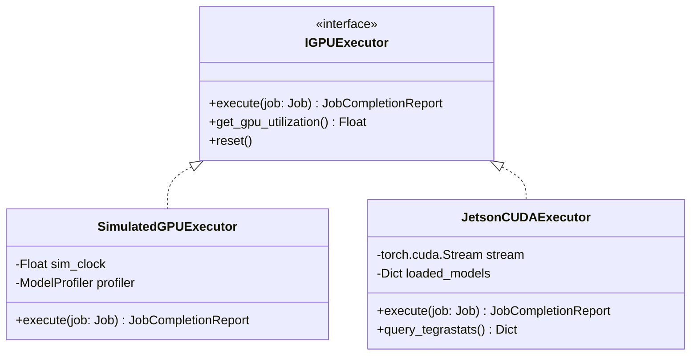
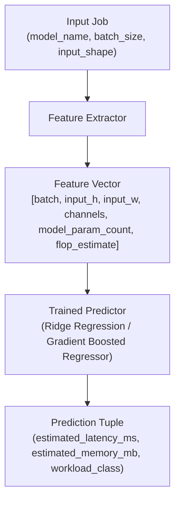

# Technical Specification: GPU-Aware Fair Scheduler for Multi-Tenant Edge AI

**Document Version:** 1.0.0  
**Status:** Approved Architecture Baseline  
**Target Platform:** Edge AI Systems (NVIDIA Jetson AGX Orin / Orin Nano / Xavier) & Cross-Platform DES (macOS / Linux / Windows)  
**Author:** Lead Systems Engineer  

---

## 1. Problem Statement

Edge AI devices (e.g., NVIDIA Jetson platforms) increasingly host multiple concurrent applications—such as robotics control, real-time computer vision, acoustic event detection, and edge speech processing. Unlike cloud servers with partitioned multi-GPU clusters, edge devices typically feature a single integrated GPU (iGPU) sharing a unified physical memory architecture (UMA) with the CPU.

Traditional operating systems schedule CPU threads preemptively at millisecond granularity using timer interrupts, task structures, and kernel-level context switching. However, edge GPU scheduling remains primitive at the user-space and runtime levels:
1. **Cooperative Non-Preemptive Execution:** GPU runtimes (CUDA / TensorRT) submit inference kernels to hardware queues that execute cooperatively to completion. Standard runtimes do not expose fine-grained hardware preemption for arbitrary multi-tenant userspace inference.
2. **Head-of-Line (HoL) Blocking:** If an unconstrained tenant launches a batch-heavy, high-latency deep learning job (e.g., YOLOv8-large on high-resolution video), it monopolizes the GPU execution engine, starving latency-sensitive tenants (e.g., audio anomaly detection or safety triggers).
3. **Absence of Tenant Isolation:** Standard CUDA streams lack tenant-level fair queuing, priority aging, deficit accounting, and GPU execution quotas. A misbehaved or bursty tenant can flood the driver queues.
4. **Memory Contention and OOM:** In unified memory edge architectures, uncontrolled concurrent launches lead to out-of-memory (OOM) kernel terminations rather than graceful backpressure.

### The Research Question
> *"How can an OS-style fair scheduling model be extended to GPU inference workloads so that multiple AI tenants can share a single edge GPU fairly and efficiently at the application/job-dispatch layer?"*

### Clear Architectural Boundary
> [!IMPORTANT]
> **No Fake GPU Preemption:** This system operates strictly at the **application/job-dispatch level**. It does **not** claim or simulate hardware-level register/SM context preemption mid-kernel. Instead, it adapts classical OS principles (Weighted Fair Queuing, Deficit Round Robin, time quanta, quotas, and priority aging) into a userspace inference arbiter that controls **when**, **in what order**, and **at what batch granularity** inference jobs are dispatched to the GPU execution pipeline.

---

## 2. Objectives

The primary objective is to design, model, evaluate, and provide an extensible software-level GPU-aware scheduling system for multi-tenant edge AI inference.

### Specific Objectives
1. **Multi-Tenant Ingress Isolation:** Isolate tenants into independent ingress queues with strict capacity limits and backpressure.
2. **Predictive Deficit Weighted Fair Queuing (P-DWFQ):** Implement a fair scheduling algorithm that allocates GPU time slices proportional to tenant weights, tracks accumulated deficit, dynamically adapts quantum sizing, and ages waiting tenants to guarantee zero starvation.
3. **Workload Characteristic Awareness:** Incorporate a workload prediction component that estimates job execution duration, memory consumption, and execution profile (GPU-bound, CPU-bound pre/post-processing, or I/O-bound) before dispatch.
4. **SLA and Quota Enforcement:** Support hard and soft GPU time quotas over sliding time windows and enforce tenant-specific priority tiers.
5. **Dual-Mode Execution Architecture:**
   - **Simulation Mode:** High-fidelity Discrete-Event Simulation (DES) engine allowing comprehensive experimentation, reproducible metric extraction, and rapid algorithm iteration on any machine without hardware dependencies.
   - **Hardware Mode:** An optional Jetson Execution Adapter interfacing with PyTorch, CUDA Streams, `torch.cuda.Event` hardware timers, and `jetson-stats` telemetry.
6. **Empirical Benchmarking Suite:** Formally benchmark the proposed scheduler against classical baselines (FIFO, Round Robin, Strict Priority) across standard operating system scheduling metrics.

---

## 3. Functional Requirements

| ID | Requirement | Description |
| :--- | :--- | :--- |
| **FR-01** | **Tenant Registration** | System must support dynamic or static registration of tenants with metadata: `tenant_id`, `name`, `weight` ($w_i > 0$), `priority` ($p_i \in [1, 10]$), `quota_pct` ($0 < q_i \le 100$), and `sla_deadline_ms`. |
| **FR-02** | **Isolated Ingress Queuing** | System must maintain dedicated FIFO queues for each tenant. Cross-tenant queue pollution is forbidden. |
| **FR-03** | **Job Ingestion & Validation** | Validate incoming jobs for valid model identifiers, batch sizes, input tensor dimensions, and client timestamps. |
| **FR-04** | **AI-Based Workload Prediction** | Before dispatch, predict expected GPU execution duration ($\hat{E}$), memory footprint ($\hat{M}$), and classification category (GPU-bound vs CPU/IO-bound) using offline profiling and linear/tree-based regression. |
| **FR-05** | **Configurable GPU Time Quantum** | Scheduler must operate using configurable base time quanta ($Q_{base}$, default 20ms–50ms) scaled dynamically by tenant weight and predicted execution profile. |
| **FR-06** | **Deficit & Quota Accounting** | Track consumed GPU time per tenant. Disallow dispatch if tenant has depleted its sliding-window quota, replenishing tokens on window slide. |
| **FR-07** | **Starvation Prevention (Aging)** | Gradually increase effective priority of waiting tenants: $P_{eff}(t) = P_{base} + \alpha \cdot \text{waiting\_time}$. |
| **FR-08** | **Atomic Batch Chunking** | Divide multi-item inference requests into atomic sub-batches that do not exceed the tenant's remaining quantum slice. |
| **FR-09** | **Pluggable Policy Engine** | Support interchangeable scheduling policies: FIFO, Standard Round Robin, Strict Priority, and P-DWFQ. |
| **FR-10** | **Telemetry Collection** | Track waiting time, execution time, turnaround time, response time, GPU duty cycle, queue depth, and drop rate at microsecond precision. |
| **FR-11** | **Discrete Event Simulation Engine** | Provide a deterministic DES engine modeling clock progression, event queues, and non-blocking job simulation. |
| **FR-12** | **Jetson Execution Adapter** | Provide an adapter executing real PyTorch/ONNX models using asynchronous CUDA streams and non-blocking hardware event synchronization. |
| **FR-13** | **Automated Comparative Benchmarking** | Execute repeatable test workloads against all 4 scheduling policies and produce comparative metric summaries and distribution plots. |

---

## 4. Non-Functional Requirements

| ID | Requirement | Metric / Criterion |
| :--- | :--- | :--- |
| **NFR-01** | **Scheduling Decision Overhead** | Scheduling loop overhead $\le 0.5\text{ ms}$ per dispatch decision on edge CPU cores. |
| **NFR-02** | **Memory Footprint** | Core scheduler state memory $\le 64\text{ MB}$; bounded queue buffers prevent memory exhaustion. |
| **NFR-03** | **Zero Starvation Guarantee** | Maximum waiting time for any job in a non-empty tenant queue is bounded: $\sup W_j < \infty$ under bounded arrival rates. |
| **NFR-04** | **Portability & Zero Hardware Lock-in** | 100% of simulation, scheduling logic, benchmarks, and tests must execute on standard Python 3.10+ without requiring an NVIDIA GPU or C++ compilation. |
| **NFR-05** | **Hardware Adaptation Gracefulness** | When running on Jetson or CUDA devices, seamlessly activate hardware execution; fallback automatically to simulation when CUDA is absent. |
| **NFR-06** | **Determinism & Reproducibility** | Two simulation runs with the same pseudo-random seed must produce bit-for-bit identical metric outputs. |
| **NFR-07** | **Extensibility** | Adding a new baseline policy or model architecture requires implementing only a single interface class without modifying the dispatcher. |

---

## 5. System Architecture

The following diagram illustrates the complete end-to-end architecture:



---

## 6. Scheduler Architecture & Life Cycle

The scheduler coordinates multi-tenant isolation, predictive batch sizing, quota tracking, and non-blocking dispatch.



---

## 7. Data Structures

The system uses strongly typed Python 3.12 dataclasses and typed enumerations.

```python
from dataclasses import dataclass, field
from enum import Enum
from typing import Optional, Dict, Any, List

class WorkloadClass(str, Enum):
    GPU_INTENSIVE = "GPU_INTENSIVE"   # Heavy matrix compute (e.g., Vision Conv/Transformer)
    BALANCED = "BALANCED"             # Moderate compute (e.g., Audio CNN)
    CPU_BOUND = "CPU_BOUND"           # High pre/post-processing, light GPU compute
    IO_BOUND = "IO_BOUND"             # Network/disk constrained sensor feed

class JobState(str, Enum):
    QUEUED = "QUEUED"
    PREDICTED = "PREDICTED"
    DISPATCHED = "DISPATCHED"
    RUNNING = "RUNNING"
    COMPLETED = "COMPLETED"
    DROPPED = "DROPPED"

@dataclass
class Job:
    """Represents an atomic AI inference request."""
    job_id: str
    tenant_id: str
    model_name: str
    input_shape: tuple[int, ...]
    batch_size: int
    arrival_time: float               # Milliseconds (Simulated or Wall-Clock)
    deadline: Optional[float] = None  # Absolute deadline in ms
    
    # Scheduling & Prediction fields
    predicted_execution_time_ms: float = 0.0
    predicted_memory_mb: float = 0.0
    workload_class: WorkloadClass = WorkloadClass.BALANCED
    
    # Lifecycle Timestamps (ms)
    start_time: Optional[float] = None
    completion_time: Optional[float] = None
    actual_execution_time_ms: float = 0.0
    state: JobState = JobState.QUEUED
    metadata: Dict[str, Any] = field(default_factory=dict)

@dataclass
class Tenant:
    """Represents a registered multi-tenant client."""
    tenant_id: str
    name: str
    weight: float                     # Relative weight w_i > 0 for fair sharing
    priority: int                     # Base priority p_i (1 = Lowest, 10 = Highest)
    gpu_quota_pct: float              # Hard limit on GPU time % (0.0 to 100.0)
    quota_window_ms: float = 1000.0   # Sliding window duration for quota enforcement
    sla_latency_target_ms: float = 100.0
    
    # Dynamic Scheduling State
    effective_priority: float = 1.0
    deficit_counter_ms: float = 0.0   # Current deficit counter (Deficit Round Robin)
    accumulated_gpu_time_ms: float = 0.0
    window_start_time: float = 0.0
    last_service_time: float = 0.0    # For priority aging calculations
    total_jobs_completed: int = 0
    total_sla_violations: int = 0

@dataclass
class SchedulingQuantum:
    """Quantum parameters for slicing inference execution."""
    base_quantum_ms: float = 20.0
    min_quantum_ms: float = 5.0
    max_quantum_ms: float = 100.0
    aging_factor_alpha: float = 0.1   # Priority boost per millisecond of wait
    starvation_threshold_ms: float = 200.0

@dataclass
class PredictionOutput:
    """Output from the AI-based Workload Predictor."""
    estimated_latency_ms: float
    estimated_memory_mb: float
    classification: WorkloadClass
    confidence_score: float
```

---

## 8. Scheduling Algorithms

### 8.1 Proposed Algorithm: Predictive Deficit Weighted Fair Queuing (P-DWFQ) with Aging

The proposed scheduler combines:
1. **Deficit Round Robin (DRR)** to accommodate discrete, non-preemptible inference jobs.
2. **Normalized Tenant Weights** to allocate proportional GPU execution time.
3. **Predictive Dynamic Quantum Scaling** ($\psi$) to prevent large vision jobs from monopolizing quantum boundaries.
4. **Starvation Prevention via Priority Aging** ($P_{eff}$).
5. **Sliding-Window Quota Clamping**.

#### Mathematical Formalism & Composite Scheduling Score

At simulation time $t \ge 0$, for each candidate job $j$ at the head of active tenant $i$'s ingress queue ($i = j.\text{tenant\_id}$), the scheduler computes an eligibility indicator $\mathcal{E}(i, t)$ and evaluates a continuous, monotonic **Composite Fair Dispatch Score** $\mathcal{S}(j, t) \in \mathbb{R}$.

1. **Sliding-Window Quota Eligibility & Headroom Ratio ($C_i(t)$):**
   In rolling measurement window $W_i$:
   $$Q_i^{\max} = W_i \cdot \frac{\text{gpu\_quota\_pct}_i}{100.0}$$
   $$C_i(t) = \frac{\text{accumulated\_gpu\_time\_in\_window}_i(t)}{Q_i^{\max}}$$
   - **Hard Quota Guard:** If quota enforcement is enabled and $C_i(t) \ge 1.0$, tenant $i$ is strictly ineligible: $\mathcal{E}(i, t) = 0$.
   - **Soft Quota Headroom Penalty:** For eligible candidates ($C_i(t) < 1.0$):
     $$\mathcal{H}_i(t) = k_q \cdot \min(1.0, C_i(t))$$

2. **Normalized Service (Virtual Runtime) & Fair Deficit ($\mathcal{F}_i(t)$):**
   Let $S_i(t)$ be the total accumulated GPU execution service time (ms) delivered to tenant $i$:
   $$v_i(t) = \frac{S_i(t)}{w_i}$$
   Across all eligible active tenants $\mathcal{A}_{\text{elig}}(t)$:
   $$\overline{v}(t) = \frac{\sum_{k \in \mathcal{A}_{\text{elig}}(t)} S_k(t)}{\sum_{k \in \mathcal{A}_{\text{elig}}(t)} w_k}$$
   The normalized fair service lag is:
   $$\mathcal{F}_i(t) = \overline{v}(t) - v_i(t) = \overline{v}(t) - \frac{S_i(t)}{w_i}$$
   - If $\mathcal{F}_i(t) > 0$, tenant $i$ has received less than its fair share, yielding a positive boost.
   - If $\mathcal{F}_i(t) < 0$, tenant $i$ has consumed excess service, penalizing monopolization.

3. **Priority & Starvation-Preventing Dynamic Aging ($\mathcal{P}(j, t)$):**
   With job queue waiting time $W_j(t) = \max(0.0, t - j.\text{arrival\_time})$:
   $$\mathcal{P}(j, t) = k_p \cdot p_i + k_a \cdot \left( \frac{W_j(t)}{T_{\text{starve}}} \right)$$
   where $p_i \in [1, 10]$ is base tenant priority, $k_p$ is priority scaling factor, $k_a$ is aging rate, and $T_{\text{starve}}$ is starvation reference baseline.
   
   **Starvation Freedom Guarantee:**  
   For any high-priority tenant $A$ and low-priority tenant $B$ with priority delta $\Delta p = p_A - p_B > 0$, the waiting low-priority job's score increases strictly at rate $\frac{k_a}{T_{\text{starve}}}$. It is guaranteed to overtake the high-priority job within bounded time:
   $$t_{\text{overtake}} \le \frac{k_p (p_A - p_B)}{k_a} \cdot T_{\text{starve}} < \infty$$
   Therefore, starvation is mathematically impossible.

4. **Short-Job Responsiveness Heuristic ($\mathcal{R}(j)$):**
   $$\mathcal{R}(j) = \frac{Q_{\text{base}}}{\max(j.\text{remaining\_gpu\_time}, Q_{\text{base}})}$$
   Bounded in $(0, 1.0]$, favoring interactive/short jobs that complete in one slice.

5. **The Composite Dispatch Score Function ($\mathcal{S}(j, t)$):**
   $$\mathcal{S}(j, t) = \mathcal{P}(j, t) + k_f \cdot \mathcal{F}_i(t) + k_r \cdot \mathcal{R}(j) - \mathcal{H}_i(t)$$
   Explicitly:
   $$\mathcal{S}(j, t) = \left[ k_p \cdot p_i + k_a \cdot \frac{t - j.\text{arrival\_time}}{T_{\text{starve}}} \right] + k_f \cdot \left( \overline{v}(t) - \frac{S_i(t)}{w_i} \right) + k_r \cdot \frac{Q_{\text{base}}}{\max(E_j, Q_{\text{base}})} - k_q \cdot C_i(t)$$

6. **Winning Job Selection:**
   $$j^* = \arg\max_{j \in \text{head}(\mathcal{A}_{\text{elig}}(t))} \mathcal{S}(j, t)$$

7. **Dynamic Quantum Allocation Slice ($Q_i(t)$):**
   $$Q_{\text{target}} = Q_{\text{base}} \cdot \left(\frac{w_i}{\overline{w}}\right) \cdot \left(1.0 + \tanh\left(\frac{\mathcal{F}_i(t)}{Q_{\text{base}}}\right)\right)$$
   $$Q_i(t) = \text{clamp}(Q_{\text{target}}, Q_{\min}, Q_{\max})$$
   $$\Delta t = \min(j^*.\text{remaining\_gpu\_time}, Q_i(t))$$

#### Algorithm Pseudo-Code

```python
def schedule_next_job(tenants: dict[str, Tenant], queues: dict[str, JobQueue], current_time: float) -> Optional[Job]:
    # Step 1: Update aging and effective priorities
    for tenant_id, tenant in tenants.items():
        if not queues[tenant_id].is_empty():
            wait_time = current_time - tenant.last_service_time
            tenant.effective_priority = tenant.priority + (aging_alpha * (wait_time / starvation_threshold))
        else:
            tenant.effective_priority = tenant.priority

    # Step 2: Filter eligible active tenants (Quota check)
    eligible_tenants = []
    for tenant_id, tenant in tenants.items():
        if queues[tenant_id].is_empty():
            continue
        if is_quota_exceeded(tenant, current_time):
            continue
        eligible_tenants.append(tenant)

    if not eligible_tenants:
        return None

    # Step 3: Sort eligible tenants by effective priority (Aging override) then round-robin order
    eligible_tenants.sort(key=lambda t: t.effective_priority, reverse=True)

    for tenant in eligible_tenants:
        job = queues[tenant.tenant_id].peek()
        predicted_time = predictor.predict_latency(job)
        
        # Calculate dynamic quantum
        normalized_weight = tenant.weight / sum(t.weight for t in eligible_tenants)
        psi = get_workload_multiplier(job.workload_class)
        quantum = clamp(base_quantum * normalized_weight * psi, min_quantum, max_quantum)
        
        # Add quantum to deficit if beginning a new round
        if tenant.deficit_counter_ms <= 0:
            tenant.deficit_counter_ms += quantum

        # Check if job fits in accumulated deficit
        if predicted_time <= tenant.deficit_counter_ms:
            # Dispatch job
            job = queues[tenant.tenant_id].dequeue()
            tenant.deficit_counter_ms -= predicted_time
            tenant.last_service_time = current_time
            return job
        else:
            # Deficit remains for next round; proceed to check next tenant to prevent HoL blocking
            continue

    # Fallback: If top job exceeds single deficit slice, dispatch atomic burst if queue has waited
    oldest_tenant = max(eligible_tenants, key=lambda t: t.effective_priority)
    job = queues[oldest_tenant.tenant_id].dequeue()
    oldest_tenant.deficit_counter_ms = 0.0
    oldest_tenant.last_service_time = current_time
    return job
```

---

## 9. Workload Model

To reflect real-world Edge AI deployments, workloads are modeled across four distinct AI domains:

| Domain | Example Model | Input Shape | Characteristics | Simulated Latency Range |
| :--- | :--- | :--- | :--- | :--- |
| **Object Detection** | YOLOv8-Nano / Small | $3 \times 640 \times 640$ | High GPU compute, high memory bandwidth | $18.0 - 45.0\text{ ms}$ |
| **Image Classification** | MobileNetV3 / ResNet-18 | $3 \times 224 \times 224$ | Moderate GPU compute, low latency | $4.0 - 10.0\text{ ms}$ |
| **Audio Processing** | Keyword Spotting (1D-CNN) | $1 \times 16000$ | Light GPU, bursty stream | $1.5 - 5.0\text{ ms}$ |
| **Sensor Anomaly** | Multi-Layer Perceptron / LSTM | $1 \times 128$ | CPU-bound feature extraction, ultra-fast GPU | $0.8 - 2.5\text{ ms}$ |

### Arrival Distribution Models
1. **Poisson Arrival Process:** Inter-arrival times $t_{inter} \sim \text{Exponential}(\lambda_i)$, representing independent random user queries.
2. **Periodic / Isochronous Stream:** $t_{inter} = \text{constant}$ (e.g., $30\text{ FPS} = 33.3\text{ ms}$ video camera frame ingestion).
3. **Bursty / Markov-Modulated:** High-rate burst clusters followed by idle intervals, simulating traffic surges.

---

## 10. Tenant Model

The system formally models heterogeneous multi-tenancy:



### Standard Tenant Tiers for Experiments

| Tenant Profile | Name | Weight ($w$) | Priority ($p$) | Quota ($q$) | SLA Target | Workload Type |
| :--- | :--- | :--- | :--- | :--- | :--- | :--- |
| **Tier 1: Safety Critical** | `Tenant-RobotControl` | $4.0$ | $10$ (Highest) | $40\%$ | $15\text{ ms}$ | Audio Anomaly / Fast Obstacle Detection |
| **Tier 2: Interactive Vision** | `Tenant-Surveillance` | $2.0$ | $5$ (Medium) | $35\%$ | $50\text{ ms}$ | YOLOv8 Object Detection |
| **Tier 3: Best-Effort Analytics** | `Tenant-Indexer` | $1.0$ | $1$ (Lowest) | $25\%$ | $250\text{ ms}$ | ResNet-18 Batch Processing |

---

## 11. GPU Job Model & Dispatch Boundary

### Non-Preemption Clarification & Mitigation
1. **Kernel Atomicity:** A CUDA kernel, once submitted to a stream, runs until completion. The scheduler cannot pause an executing kernel at $50\%$ progress without hardware support.
2. **Dispatch-Level Slicing:** The scheduler preempts at the **Job / Batch boundary**.
3. **Atomic Chunking:** If a client submits a batch of 8 images ($B = 8$), the admission controller or scheduler chunks it into sub-batches ($B_1 = 2, B_2 = 2, \dots$) matching the tenant's quantum. Between sub-batch dispatches, the scheduler can interleave other tenants' jobs.

```
Incoming Request: Tenant A, Batch = 8 (Est. 64ms, Quantum = 20ms)
Chunked: [Job A.1: Batch 2, 16ms] -> [Job A.2: Batch 2, 16ms] -> ...
Dispatch Sequence:
[Job A.1 (16ms)] ---> [Job B.1 (Audio, 4ms)] ---> [Job A.2 (16ms)]
```

---

## 12. Metrics & Formal Formulations

The telemetry system records microsecond-level timestamps: $t_{arr}(j)$, $t_{start}(j)$, $t_{comp}(j)$.

### Metric Formulations

1. **Waiting Time ($W_j$):** Time elapsed between job arrival and execution start:
   $$W_j = t_{start}(j) - t_{arr}(j)$$

2. **Execution Time ($E_j$):** Active GPU duration:
   $$E_j = t_{comp}(j) - t_{start}(j)$$

3. **Turnaround Time ($T_j$):** Total duration from arrival to completion:
   $$T_j = t_{comp}(j) - t_{arr}(j) = W_j + E_j$$

4. **Response Time ($R_j$):** Time from arrival to initial output delivery (for atomic jobs, $R_j = W_j + E_j$).

5. **Overall GPU Utilization ($U$):**
   $$U = \frac{\sum_{j \in \mathcal{C}} E_j}{T_{total}} \times 100\%$$

6. **System Throughput ($\Theta$):**
   $$\Theta = \frac{|\mathcal{C}|}{T_{total}} \quad (\text{Jobs per second})$$

7. **Jain's Fairness Index ($\mathcal{J}$):**  
   Evaluates fairness of GPU time allocation relative to tenant weights:
   $$x_i = \frac{\text{Allocated GPU Time}_i}{w_i \cdot \sum_j \text{Allocated GPU Time}_j}$$
   $$\mathcal{J} = \frac{\left(\sum_{i=1}^{n} x_i\right)^2}{n \sum_{i=1}^{n} x_i^2} \quad \text{where } \mathcal{J} \in \left[\frac{1}{n}, 1.0\right]$$
   A value of $\mathcal{J} = 1.0$ indicates perfect weighted fairness.

8. **SLA Violation Rate ($\text{SVR}_i$):**
   $$\text{SVR}_i = \frac{\sum_{j \in \mathcal{C}_i} \mathbb{I}(T_j > \text{SLA}_i)}{|\mathcal{C}_i|}$$

9. **Maximum Waiting Time ($\sup W_i$):** Quantifies worst-case starvation.

---

## 13. Baseline Algorithms

To validate the proposed P-DWFQ scheduler, three classic OS scheduling policies are implemented:

1. **FIFO (First-In-First-Out):**
   - Single global queue across all tenants.
   - Non-preemptive, zero tenant awareness, zero fairness guarantees.
   - Demonstrates severe HoL blocking when heavy vision jobs arrive before urgent audio jobs.

2. **Standard Round Robin (RR):**
   - Cyclic round-robin across tenant queues.
   - Static time quantum $Q_{base}$ for all tenants.
   - Ignores tenant weights ($w_i$), priorities ($p_i$), and workload characteristics.

3. **Strict Priority (SP):**
   - Always dispatches from the highest-priority non-empty tenant queue.
   - Lower-priority tenants receive zero GPU time as long as higher-priority queues have jobs.
   - Demonstrates severe starvation of background analytics tenants.

4. **Proposed Scheduler (P-DWFQ):**
   - Weighted deficit allocation + predictive quantum sizing + aging + quota enforcement.

---

## 14. Simulation Model (Discrete Event Simulation - DES)

The DES engine enables rigorous, zero-dependency experimentation on any OS (macOS, Linux, Windows).

### DES Architecture



### Virtual GPU Execution Models
1. **Calibrated Analytical Model:**  
   Execution time is calculated using profiled model parameters:
   $$E = \beta_0 + \beta_1 \cdot \text{BatchSize} + \beta_2 \cdot \text{FLOPs} + \epsilon, \quad \epsilon \sim \mathcal{N}(0, \sigma^2)$$
2. **Empirical Trace Replay:**  
   Pre-recorded real execution traces from NVIDIA Jetson AGX Orin for exact fidelity.

---

## 15. Hardware Integration Strategy (Jetson Execution Adapter)

The software architecture decouples the scheduler from the execution runtime via an abstract interface:



### Real Hardware Implementation Details
- **PyTorch / ONNX Runtime Backend:** Preloads real models (e.g., PyTorch MobileNetV3, YOLO ONNX) in unified memory.
- **Asynchronous CUDA Streams:** Dispatches jobs on dedicated `torch.cuda.Stream` objects.
- **Hardware Timing:** Uses `torch.cuda.Event(enable_timing=True)`:
  ```python
  start_event.record(stream)
  # Run model inference asynchronously
  output = model(input_tensor)
  end_event.record(stream)
  # Event synchronization (non-blocking query or join)
  end_event.synchronize()
  elapsed_ms = start_event.elapsed_time(end_event)
  ```
- **TegraStats / Jetson-Stats Integration:** Polls `/sys/devices/gpu.0/` or `jtop` for physical thermal, power, and hardware engine utilization.
- **Graceful Fallback:** If `torch.cuda.is_available()` returns `False`, automatically logs an informative notice and invokes `SimulatedGPUExecutor`.

---

## 16. Workload Prediction Engine

The prediction component provides the scheduler with foresight into job runtime and resource footprint.



### Model Profiling & Training
- The system includes an automated offline profiler (`ModelProfiler`) that runs calibration sweeps across model architectures and batch sizes ($1, 2, 4, 8, 16$).
- A lightweight regressor (`PredictorModel`, using scikit-learn or pure NumPy polynomial regression) is fitted on calibration data.
- Inference latency of the predictor itself is $< 0.05\text{ ms}$, preserving the sub-millisecond scheduling overhead requirement.

---

## 17. Testing Strategy

The test suite ensures mathematical correctness, invariance validation, and robust fault handling.

### Test Categories
1. **Unit Tests:**
   - Queue isolation and backpressure mechanics.
   - Deficit counter accumulation and deduction arithmetic.
   - Priority aging equation: verify that $P_{eff}$ strictly increases with waiting time.
   - Jain's Fairness Index computation against verified mathematical corner cases ($\mathcal{J} = 1.0$ for equal shares, $\mathcal{J} = 1/n$ for single-tenant monopolization).
   - Workload predictor inference accuracy.
2. **Invariance Tests:**
   - **Zero Starvation Invariant:** Under sustained arrival from high-priority tenants, low-priority jobs must still be served within finite time $T \le T_{starve\_max}$.
   - **Quota Bound Invariant:** No tenant can exceed its assigned quota window by more than 1 atomic quantum slice.
   - **Monotonic Clock Invariant:** In simulation, virtual clock time must strictly increase.
3. **Integration Tests:**
   - Full 10,000-job simulation run across FIFO, RR, SP, and P-DWFQ.
   - Verification that all completed jobs yield well-formed metrics.

---

## 18. Benchmark & Evaluation Strategy

### Experimental Scenarios

1. **Scenario 1: Balanced Multi-Tenant Load**
   - 3 Tenants with identical weights ($1:1:1$) and identical arrival distributions.
   - Verifies baseline fairness ($\mathcal{J} \approx 1.0$).

2. **Scenario 2: Rogue Tenant (Overload & Starvation Stress Test)**
   - Tenant 1 submits heavy vision jobs (YOLOv8, 50ms) at $100\text{ req/s}$ (flooding the system).
   - Tenant 2 submits light audio jobs (2ms) at $20\text{ req/s}$.
   - Tenant 3 submits periodic sensor jobs (1ms) at $10\text{ req/s}$.
   - Evaluates whether FIFO starves Tenants 2 & 3, while P-DWFQ isolates Tenant 1 and protects latency-sensitive tenants.

3. **Scenario 3: Heterogeneous Priority & Quota Enforcement**
   - Tenant 1: High Priority (10), Weight 4.0, Quota 50%.
   - Tenant 2: Medium Priority (5), Weight 2.0, Quota 30%.
   - Tenant 3: Low Priority (1), Weight 1.0, Quota 20%.
   - Evaluates whether allocations match the target ratio $4:2:1$ and quotas are strictly respected.

### Output Artifacts
- **JSON & CSV Tables:** Raw per-job and aggregate summaries.
- **ASCII Comparison Table:** Terminal-friendly metrics display.
- **Visualizations (Matplotlib):**
  - CDF (Cumulative Distribution Function) of Turnaround Latency.
  - Time-series plot of Instantaneous Fairness Index $\mathcal{J}(t)$.
  - Bar chart of Tenant GPU Time Share vs Nominal Weight Share.
  - Starvation comparison: Max Waiting Time across algorithms.

---

## 19. Project Directory Structure

```
Operating Systems Project/
├── PROJECT_SPECIFICATION.md          # Complete technical specification (this document)
├── README.md                          # Project documentation and quickstart guide
├── pyproject.toml                     # Modern build and dependency configuration
├── requirements.txt                   # Frozen production dependencies
├── configs/
│   ├── default_simulation.yaml        # Default simulation configuration
│   ├── tenants.yaml                   # Tenant definitions (weights, priorities, quotas)
│   ├── workloads.yaml                 # AI workload catalog (vision, audio, sensor)
│   └── hardware_jetson.yaml           # Jetson hardware adapter configuration
├── src/
│   ├── __init__.py
│   ├── core/
│   │   ├── __init__.py
│   │   ├── types.py                   # Enums, Dataclasses (Job, Tenant, MetricRecord)
│   │   ├── tenant.py                  # Tenant state, quota tracker, aging logic
│   │   ├── job.py                     # Job definitions and state transitions
│   │   └── queues.py                  # Multi-tenant isolated queues with backpressure
│   ├── scheduler/
│   │   ├── __init__.py
│   │   ├── base.py                    # BaseScheduler abstract interface
│   │   ├── fifo.py                    # Baseline 1: First-In First-Out
│   │   ├── round_robin.py             # Baseline 2: Round Robin
│   │   ├── strict_priority.py         # Baseline 3: Strict Priority
│   │   └── pdwfq.py                   # Proposed: Predictive Deficit Weighted Fair Queuing
│   ├── predictor/
│   │   ├── __init__.py
│   │   ├── profiler.py                # Model profiling & calibration data collector
│   │   ├── feature_extractor.py       # Job tensor & metadata feature extraction
│   │   └── model.py                   # Regressor for runtime/VRAM prediction
│   ├── execution/
│   │   ├── __init__.py
│   │   ├── base.py                    # IGPUExecutor abstract base class
│   │   ├── sim_executor.py            # Simulated GPU execution engine
│   │   └── jetson_adapter.py          # Real hardware adapter (CUDA / PyTorch)
│   ├── simulation/
│   │   ├── __init__.py
│   │   ├── engine.py                  # Discrete Event Simulation (DES) core
│   │   ├── events.py                  # Simulation event classes (Arrival, Dispatch, Complete)
│   │   └── generator.py               # Synthetic workload generator (Poisson, Bursty)
│   ├── telemetry/
│   │   ├── __init__.py
│   │   ├── collector.py               # Metrics collection & timestamp recording
│   │   ├── metrics.py                 # Mathematical metrics (Jain's index, Turnaround, SLA)
│   │   └── visualizer.py              # Publication-grade chart generation
│   └── cli/
│       ├── __init__.py
│       └── main.py                    # Unified CLI entrypoint
├── tests/
│   ├── __init__.py
│   ├── unit/
│   │   ├── test_queues.py             # Test isolated queues and backpressure
│   │   ├── test_schedulers.py         # Test FIFO, RR, SP, P-DWFQ logic
│   │   ├── test_metrics.py            # Test Jain's index & telemetry calculations
│   │   └── test_predictor.py          # Test runtime regressor & profiling
│   └── integration/
│       ├── test_sim_pipeline.py       # Full end-to-end simulation runs
│       └── test_invariants.py         # Starvation and quota invariance tests
├── benchmarks/
│   ├── __init__.py
│   ├── run_benchmarks.py              # Automated runner for comparative studies
│   └── scenarios/
│       ├── scenario_balanced.py       # Balanced load scenario
│       ├── scenario_rogue.py          # Flooding rogue tenant scenario
│       └── scenario_heterogeneous.py  # Mixed SLA & priority scenario
└── scripts/
    ├── run_simulation.sh              # Quick script to execute simulation
    └── run_benchmarks.sh              # Quick script to execute benchmark suite
```

---

## 20. API & Module Boundaries

The codebase enforces clean object-oriented abstraction using Python's `abc` module and typing protocols.

### Core Interface: `BaseScheduler`

```python
from abc import ABC, abstractmethod
from typing import Optional, Dict
from src.core.types import Job, Tenant
from src.core.queues import TenantQueueManager

class BaseScheduler(ABC):
    """Abstract interface for all scheduling policies."""

    def __init__(self, tenants: Dict[str, Tenant], queue_manager: TenantQueueManager):
        self.tenants = tenants
        self.queue_manager = queue_manager

    @abstractmethod
    def schedule(self, current_time_ms: float) -> Optional[Job]:
        """Selects the next job to dispatch to the GPU.
        
        Args:
            current_time_ms: Current simulation or wall-clock time in ms.
            
        Returns:
            The selected Job instance, or None if no eligible job is available.
        """
        pass

    @abstractmethod
    def on_job_completed(self, job: Job, actual_gpu_time_ms: float, completion_time_ms: float) -> None:
        """Callback invoked upon completion of an inference execution.
        
        Args:
            job: Completed Job instance.
            actual_gpu_time_ms: Elapsed execution time on GPU in ms.
            completion_time_ms: Timestamp of completion in ms.
        """
        pass
```

### Core Interface: `IGPUExecutor`

```python
from abc import ABC, abstractmethod
from src.core.types import Job

class IGPUExecutor(ABC):
    """Abstract interface for GPU execution backends."""

    @abstractmethod
    def execute(self, job: Job) -> float:
        """Executes the given job on the backend.
        
        Args:
            job: Job to execute.
            
        Returns:
            Actual execution duration in milliseconds.
        """
        pass

    @abstractmethod
    def get_hardware_telemetry(self) -> dict:
        """Retrieves instantaneous hardware status (utilization, memory, temp)."""
        pass
```

---

## 21. Expected Inputs and Outputs

### Inputs
1. **Configuration Files (`configs/*.yaml`):**
   - Tenant definitions: Weights, priorities, quotas, and SLA thresholds.
   - Workload parameters: Arrival rate $\lambda$, duration, random seed.
   - Execution mode: `--mode sim` (default) or `--mode jetson`.
2. **CLI Commands:**
   ```bash
   # Run discrete event simulation with proposed scheduler
   python -m src.cli.main simulate --policy pdwfq --duration 60000 --seed 42

   # Run automated comparative benchmark across all policies
   python -m benchmarks.run_benchmarks --scenario rogue --output-dir results/
   ```

### Outputs
1. **Console Output:** Formatted summary table displaying:
   - Total Jobs Completed, Throughput (req/s), GPU Utilization (%).
   - Mean / P95 / P99 Waiting Time and Turnaround Time per tenant.
   - Jain's Fairness Index ($\mathcal{J}$).
   - SLA Violation Rate (%).
2. **Structured Artifacts (`results/`):**
   - `summary_metrics.json`: Full machine-readable metrics.
   - `jobs_trace.csv`: Complete trace of every job (arrival, start, end, wait).
   - `fairness_over_time.png`: Chart of Jain's index evolution.
   - `latency_cdf.png`: Cumulative latency distribution comparing FIFO, RR, SP, P-DWFQ.

---

## 22. Failure Handling & Edge Cases

| Scenario | Risk | Mitigation Strategy |
| :--- | :--- | :--- |
| **Rogue Tenant Queue Flood** | Memory exhaustion from unbounded request ingress | Ingress queues enforce `max_capacity`. When full, admission controller rejects new arrivals with `JobState.DROPPED` and records drop metric. |
| **All Tenants Quota Depleted** | GPU sits idle while work exists | Dynamic Quota Leeway: If all queues have work but quotas are depleted, scheduler grants an elastic best-effort borrow slice rather than idling the GPU. |
| **Predictor Over/Under Estimation** | Inaccurate runtime prediction causes quantum overrun | Deficit Adjustment: Accounting deducts **actual** measured execution time, not predicted time. If a job overruns, the deficit counter goes negative, penalizing the tenant in subsequent rounds. |
| **Jetson / CUDA Driver Error** | Hardware crash or out-of-memory kernel launch | CUDA exception catcher traps `torch.cuda.OutOfMemoryError`, invokes `torch.cuda.empty_cache()`, marks job failed, and penalizes tenant. |
| **Zero Active Tenants** | Busy-wait loop consuming CPU | Simulation engine advances virtual clock directly to next `JOB_ARRIVAL` event. Hardware mode uses non-blocking condition variables (`wait_timeout`). |

---

## 23. Reproducibility Strategy

1. **Deterministic Pseudo-Random Seeds:** All stochastic generators (Poisson arrivals, noise distributions, burst timings) accept an explicit seed (`--seed 42`).
2. **Standardized Synthetic Models:** Synthetic workload profiles are pre-calibrated and bundled with deterministic polynomial coefficients.
3. **Hardware Independence:** Any reviewer or engineer without an NVIDIA Jetson can run the entire simulation and benchmark suite directly on any CPU laptop with identical results.
4. **Single-Command Benchmark Execution:** A top-level script executes all scenarios and generates graphs in a single step:
   ```bash
   bash scripts/run_benchmarks.sh
   ```

---

## 24. Sequential Implementation Roadmap

The implementation will proceed according to the following phased checklist:

- [x] **Phase 1: Project Scaffolding & Core Data Structures**
  - Create directory layout, `pyproject.toml`, and `requirements.txt`.
  - Implement `src/core/types.py`, `src/core/job.py`, `src/core/tenant.py`.
  - Implement `src/core/queues.py` with thread-safe / sim-compatible multi-tenant isolated queues.
  - Implement unit tests for queue isolation and tenant data structures.

- [x] **Phase 2: Baseline Schedulers & Scheduler Abstraction**
  - Implement `src/scheduler/base.py` (`BaseScheduler`).
  - Implement `src/scheduler/fifo.py` (First-In First-Out).
  - Implement `src/scheduler/round_robin.py` (Round Robin with quantum).
  - Implement `src/scheduler/priority.py` (Strict Priority).
  - Implement `src/scheduler/weighted_round_robin.py` (Weighted Round Robin).
  - Write unit tests verifying baseline dispatch behaviors.

- [x] **Phase 3: Workload Profiling & AI Predictor**
  - Implement `src/predictor/features.py` (10 extracted operational features).
  - Implement `src/predictor/dataset.py` (synthetic dataset generator, CSV persistence, stratified split).
  - Implement `src/predictor/model.py` (lightweight dual classification and latency regression model).
  - Implement `src/predictor/trainer.py` and `src/predictor/evaluator.py` (metrics: Accuracy, Precision, Recall, F1, MAE).
  - Implement `src/predictor/inference.py` (runtime edge engine with heuristic fallback).
  - Implement unit tests for feature extraction, training, serialization, and fallback.

- [x] **Phase 4: Proposed GPU-Aware Fair Scheduler (P-DWFQ)**
  - Implement `src/scheduler/fair_scheduler.py`:
    - Continuous, monotonic composite dispatch score $\mathcal{S}(j, t)$.
    - Dynamic quantum calculation with workload multiplier $\psi(c)$.
    - Starvation prevention via linear priority aging ($t_{\text{overtake}} < \infty$).
    - Sliding-window quota tracking and enforcement.
  - Write unit tests for zero starvation, deficit correctness, and quota clamping.

- [ ] **Phase 5: Execution Engines & Discrete Event Simulation**
  - Implement `src/execution/base.py` (`IGPUExecutor`).
  - Implement `src/execution/sim_executor.py` (Calibrated virtual GPU execution).
  - Implement `src/simulation/events.py` and `src/simulation/engine.py` (Discrete Event Simulator).
  - Implement `src/simulation/generator.py` (Poisson, Periodic, Bursty workload generator).
  - Implement `src/execution/jetson_adapter.py` (PyTorch CUDA stream & event adapter).

- [ ] **Phase 6: Telemetry, Metrics & Visualizer**
  - Implement `src/telemetry/metrics.py` (Waiting time, Turnaround, Jain's Fairness Index, SLA violation rate).
  - Implement `src/telemetry/collector.py` (Trace recording and aggregate stats).
  - Implement `src/telemetry/visualizer.py` (Publication-quality Matplotlib plots: CDFs, bar charts, time-series).

- [ ] **Phase 7: CLI Interface & Configuration System**
  - Create YAML configuration files (`tenants.yaml`, `workloads.yaml`, `default_simulation.yaml`).
  - Implement `src/cli/main.py` with commands for `simulate`, `benchmark`, and `profile`.
  - Implement shell helper scripts (`run_simulation.sh`, `run_benchmarks.sh`).

- [ ] **Phase 8: Benchmarking, Validation & Final Verification**
  - Implement `benchmarks/scenarios/` (Balanced, Rogue/Stress, Heterogeneous).
  - Implement `benchmarks/run_benchmarks.py` comparing FIFO, RR, SP, and P-DWFQ.
  - Run full test suite and verify 100% pass rate.
  - Generate benchmark results and publication-grade plots demonstrating fairness and starvation prevention.
  - Finalize documentation in `README.md`.
